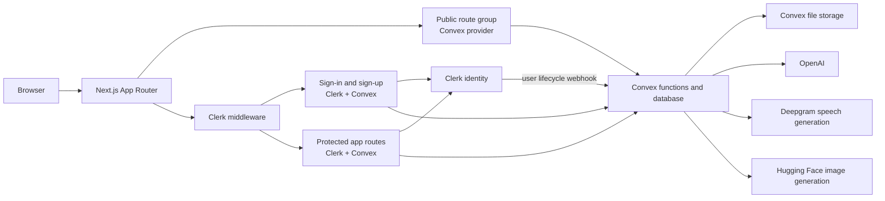
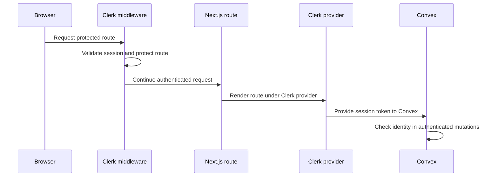

# System architecture

PodcastX uses the Next.js App Router for the web application, Clerk for authentication, and Convex for data, server actions, and file storage. AI services are called from Convex actions so their credentials stay on the server side.

## High-level view

The public homepage is outside the Clerk provider tree and uses a standard Convex provider for public podcast queries. Auth and protected route groups use `ConvexClerkProvider`, which connects Clerk session tokens to Convex.

## Route groups

| URL | App Router location | Access and provider behavior |
| --- | --- | --- |
| `/` | `app/(public)/page.tsx` | Public. Fetches initial trending podcasts on the server and uses Convex without loading Clerk's client provider. |
| `/sign-in` and `/sign-up` | `app/(auth)/...` | Public Clerk authentication screens, wrapped in `ConvexClerkProvider`. |
| Discover, create, podcast, and profile routes | `app/(root)/...` | Protected by Clerk middleware and wrapped in the authenticated Convex provider. |

Route group names in parentheses organize layouts without becoming part of the URL.

## Authentication and access flow

The `/` homepage is excluded from the middleware matcher because it is public. Sign-in and sign-up routes may pass through middleware, but the route matcher treats them as public. Other application routes are protected.

## Podcast creation flow

1. The creator enters a title, description, script or topic, voice choices, and image prompt in the create form.
2. Convex actions call OpenAI for conversational text processing, Deepgram for speech generation, and Hugging Face for AI artwork when those features are selected.
3. The browser uploads generated audio and image files to Convex storage using generated upload URLs. Custom artwork can also be uploaded directly.
4. The create mutation associates the stored media and podcast metadata with the authenticated user.
5. Convex queries provide trending, search, creator profile, and podcast detail data to the app.

## Backend modules and data

- `convex/schema.ts` defines `users` and `podcasts` tables, including search indexes for podcast author, title, and description.
- `convex/podcasts.ts` contains podcast creation, retrieval, search, view-count, and deletion functions.
- `convex/users.ts` contains user lookup and internal user lifecycle mutations.
- `convex/files.ts` creates upload URLs for Convex storage.
- `convex/openai.ts` contains actions that integrate the audio and image generation services.
- `convex/http.ts` exposes the `/clerk` webhook endpoint and verifies webhook signatures before updating user records.

## Provider placement

- `app/layout.tsx` provides shared document metadata and the audio state provider.
- `app/(public)/layout.tsx` provides Convex data access without Clerk.
- `app/(auth)/layout.tsx` and `app/(root)/layout.tsx` provide Clerk and authenticated Convex integration only where needed.
- `middleware.ts` protects non-public routes. Static assets are excluded by its matcher.

For setup and environment configuration, see [Local development](./development.md) and [Production deployment](./deployment.md).
